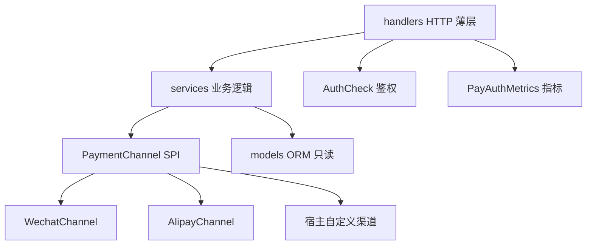
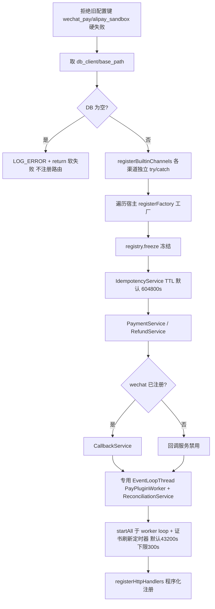
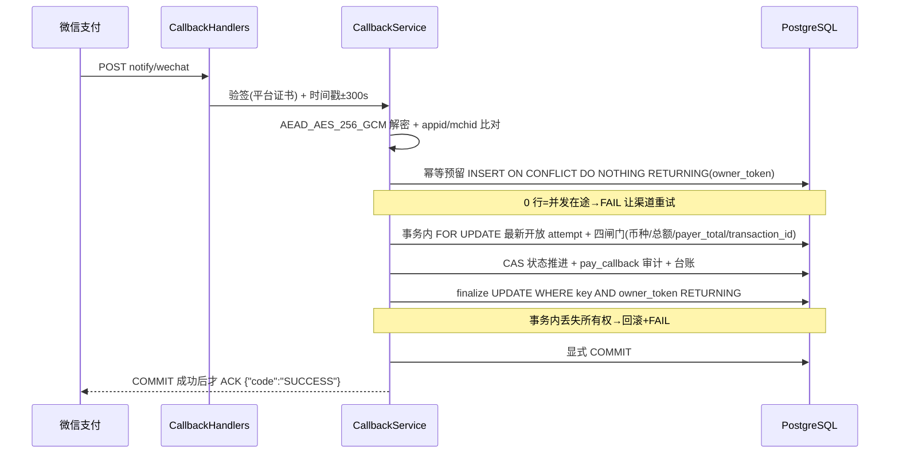
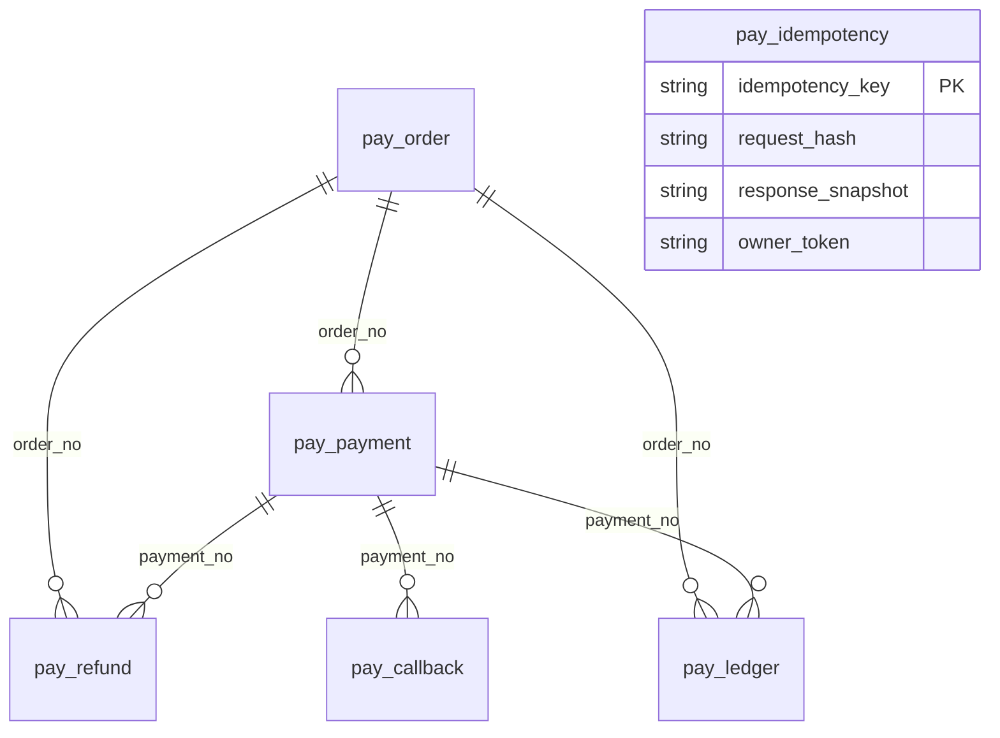

# drogon-pay 项目深度分析（Repo Wiki 前置研究）

本报告为构建 Repo Wiki 知识库所做的一次全仓实证分析：四个并行研究方向
（插件核心与 HTTP 层 / 服务与渠道层 / 示例宿主与前端 / 工程基建与数据层）
逐文件阅读后的结论汇总。所有结论以**当前代码**为准并附证据位置；
与既有文档不一致之处集中列于「文档与代码口径差异清单」，供 Wiki 生成
（`.qoder/repowiki/wiki_plan.yaml`）与后续文档修订引用。

## 目录

1. [项目定位与发布物](#一项目定位与发布物)
2. [分层架构与装配流程](#二分层架构与装配流程)
3. [HTTP 表面：路由、鉴权与错误映射](#三http-表面路由鉴权与错误映射)
4. [核心服务深度分析](#四核心服务深度分析)
5. [内置渠道实现对比](#五内置渠道实现对比)
6. [数据层：模型、状态机与迁移](#六数据层模型状态机与迁移)
7. [示例宿主与管理前端](#七示例宿主与管理前端)
8. [工程基建：构建、测试、CI、发布与部署](#八工程基建构建测试ci发布与部署)
9. [文档与代码口径差异清单](#九文档与代码口径差异清单)
10. [已知风险与待改进项](#十已知风险与待改进项)

---

## 一、项目定位与发布物

drogon-pay 是 Drogon C++ 框架的可复用支付插件库：完整支付能力
（创建 / 扫码 / 查询 / 退款 / 回调验签 / 对账 / 幂等）封装为标准
`drogon::Plugin`，以 Conan 静态库包发布，CMake 目标 `DrogonPay::DrogonPay`。

| 事实 | 值 | 证据 |
|------|----|------|
| 当前版本 | 1.1.0（四处声明源） | `CMakeLists.txt`、`conanfile.py`、`examples/pay-admin/package.json`、`examples/pay-server/openapi.yaml` |
| 包类型 | static-library | `conanfile.py` |
| Drogon | 1.9.13 钉死（静态库 ABI 硬约束，库与宿主必须同版） | `conanfile.py`、`conan.lock` |
| OpenSSL / jsoncpp | 3.5.7 / 1.9.5（force 覆盖） | `conanfile.py` |
| 公共 API | 仅 4 个头文件，白名单冻结 | `libs/drogon-pay/include/drogon_pay/`、`scripts/check_architecture.py` |
| 唯一发布物 | `libs/drogon-pay/`（examples/tests 不进包） | `conanfile.py` exports_sources |

宿主三步接入：Conan 依赖 → `find_package(DrogonPay)` + 链接 →
config.json 插件块；再执行迁移建表。消费者视角由 `test_package/`
端到端验证（详见第八节）。

## 二、分层架构与装配流程

### 2.1 分层与依赖方向



依赖方向单向：`handlers → services → channels → models`，由
`scripts/check_architecture.py` 在 CI 强制四条规则：

1. 库源码不得 include `examples/` 任何内容；
2. 公共头不得泄漏 `src/` 内部实现；
3. services 只依赖 SPI，不得 include 具体渠道头
   （`dynamic_pointer_cast` 能力访问放在 handlers 层，
   `PayPlugin::alipayClient()` 是唯一 SPI 白名单例外）；
4. 公共 API 冻结为 4 头白名单，新增头必须同 PR 改白名单。

### 2.2 PayPlugin 装配顺序

`libs/drogon-pay/src/PayPlugin.cc:152-325` 的 `initAndStart`：



要点：

- **冻结机制**（`libs/drogon-pay/src/ChannelRegistry.cc`）：工厂表用
  函数内静态避免 SIOF；`freeze()` 后 `add` 一律忽略；`find` 运行期
  无锁查表，未知渠道返回 nullptr，调用方必须映射
  `CHANNEL_NOT_AVAILABLE`，无隐式兜底。
- **路由全部程序化注册**（`app.registerHandler`），不用
  `ADD_METHOD_TO` 静态注册——静态库链接会丢自注册符号。
  `drogon_pay::ensureLinked()` 是同类问题的公共 API 保险。
- **异常屏障**（`PayPlugin.cc:53-106`）：guarded 包装用 atomic CAS
  保证只响应一次；handler 响应前抛异常才回 500，防 trantor 重抛崩进程。
- 插件缺失时统一 `respondPluginUnavailable`：code 1501 + HTTP 503
  （`libs/drogon-pay/src/handlers/PluginGuard.h:29-42`）。

### 2.3 渠道 SPI 契约

`libs/drogon-pay/include/drogon_pay/PaymentChannel.h:36-111`：

- 所有方法**线程安全**（Drogon IO 线程并发调用）；
- 出站 HTTP 必须复用连接（每事件循环一个 keep-alive HttpClient）；
- 方法集：`name` / `isConfigured` / `createPayment` / `createQRPayment` /
  `queryPayment` / `closeOrder`（默认不支持）/ `refund` / `queryRefund` /
  `verifyCallback` / `onStart` / `onStop`；
- 回调归一化为 `CallbackEvent`（paid / amountTotal 分 / rawPayload）；
- 渠道独有能力留在具体类，调用点 `dynamic_pointer_cast`，避免 SPI 膨胀。

## 三、HTTP 表面：路由、鉴权与错误映射

### 3.1 路由表

注册点 `libs/drogon-pay/src/PayPlugin.cc:357-417`；`base` 默认 `/api/pay`。

| 方法 | 路径 | 鉴权 |
|------|------|------|
| POST | base/create | API Key |
| POST | /api/qrpay/create（base 非默认时 base/qrpay/create） | API Key |
| GET | base/query | API Key + scope `order_query` |
| POST | base/refund | API Key + scope `refund` |
| GET | base/refund/query | API Key + scope `refund_query` |
| GET | base/orders | API Key |
| GET | base/reconcile/summary | API Key + scope `reconcile` |
| GET | base/metrics/auth | API Key |
| GET | base/metrics/auth.prom | API Key |
| POST | base/notify/wechat | 开放（渠道签名验证） |
| POST | base/notify/alipay | 开放（渠道签名验证） |

所有业务路由带 OPTIONS（CORS 预检直通）。契约唯一来源是
`examples/pay-server/openapi.yaml`，`scripts/check_openapi_routes.py`
双向比对代码与契约，任一侧缺失即 CI 失败。

### 3.2 鉴权流程

`libs/drogon-pay/src/handlers/AuthCheck.cc`：

- 密钥源：`custom_config.pay.api_keys[]` + 环境 `PAY_API_KEY` /
  `PAY_API_KEYS`（逗号分隔）；**未配置任何密钥 → 503**（fail-closed）。
- 取 `X-Api-Key` 或 `Authorization: Bearer`；缺失或不匹配 → 401。
  比较用 `CRYPTO_memcmp` 常量时间、全量扫描不提前返回，日志不记密钥内容。
- scope 由 base 相对后缀解析；仅当配置了 `api_key_scopes` /
  `api_key_default_scopes` 才校验，不符 → 403。
- 四个 atomic 计数器（missing_key / invalid_key / scope_denied /
  not_configured）导出为 `pay_auth_*_total`
  （`libs/drogon-pay/src/handlers/PayAuthMetrics.cc:50-53`）。

### 3.3 错误码 → HTTP 映射

`libs/drogon-pay/src/handlers/PayHandlers.cc:17-39`：

| 业务码 | HTTP | 语义 |
|--------|------|------|
| 1404 / 1004 | 404 | 资源不存在 |
| 1001 / 1400 / 400 | 400 | 参数错误 |
| 1409 | 409 | 幂等冲突 |
| 1501 | 503 | 自身依赖/渠道未就绪 |
| 1502 | 502 | 上游业务失败 |
| 1002 / 1003 / 其他 | 500 | 内部错误 |

回调路由不走此表：微信错误恒 500；支付宝用字符串 `FAIL`/成功 JSON。
响应信封 `{code, message, data?}`；金额一律**元单位十进制字符串**
（`^\d+(\.\d{1,2})?$`），落库 `VARCHAR(32)`，禁止分单位整数与 JSON number。

## 四、核心服务深度分析

### 4.1 PaymentService（支付创建与查询）

`libs/drogon-pay/src/services/PaymentService.cc`（约 3800 行）。

**create 路径**（`createPayment:486` → `proceedCreatePayment:716`）：

1. SHA256 请求哈希（order_no/amount/currency/description）→
   `checkAndSetStatus` 分流 Conflict / InProgress / Error / Replay；
2. 金额、notifyUrl（SSRF 防护）、timeExpire、微信单号字段校验，
   失败即 `clearReservation`；
3. **订单 INSERT(CREATED) + 支付 INSERT(INIT) 同一事务，显式 COMMIT
   后才调渠道**（:837-903）；
4. 渠道成功用**列级 CAS**：支付行仅 INIT/PROCESSING→PROCESSING，
   订单行仅 CREATED/PAYING→PAYING（:1108-1144），防止回滚快回调已结算状态。

**qrpay 路径**（`createQRPayment:1265`）差异：JSON 入参；幂等键可派生
`QR_<orderNo>_<channel>`；强制 user_id>0；**无事务**，先探测复用订单
（PAID/SUCCESS/REFUNDED 拒绝、金额按分比较、币种/渠道/属主一致），
再查已结算支付行拒绝二次出码；顺序 insertQrOrder → bookQrPayment(INIT)
→ offerQrChannel。`pay_payment.order_no` 非唯一键，一次尝试追加一行。

**判死规则**（两路径共用 `attemptCertainlyNotCreated:327`）：
仅渠道错误信封 / 带信封 HTTP 4xx / 本地故障可判死；超时、无信封 4xx、
2xx 无码一律**留在途**等回调或对账收敛——把结果不确定的尝试置终态，
等于让用户仍能支付的一笔交易从所有恢复视角里消失。
`markQrPaymentFailed:1695` 只关支付行不动订单（旧码可能仍有效）。

**查询**：`queryOrder:2134` 先 DB 再渠道实时查询，渠道失败降级
code=1 附 `*_query_error`；`queryOrderList:3658` 参数化 LEFT JOIN，
limit 钳制 [1,100] 默认 50。支付宝 `TRADE_CLOSED` 映射订单 FAILED、
支付 **FAIL**（:2923-2929，修复过 FAILED 拼写导致 FAIL 查询漏行）；
PAID 前有双重金额闸门，只选最新「可承载资金」attempt。

### 4.2 RefundService（退款）

`libs/drogon-pay/src/services/RefundService.cc` 流程链：
`createRefund:229` → `proceedRefund:389` → 订单流/金额校验/在途检查 →
`proceedWithInsert:938` → `invokeRefundChannel:1272`。

- **超退防护**：事务内 `FOR UPDATE` 锁支付行（:1003）→ 锁内
  SUM(REFUND_INIT/REFUNDING/REFUND_SUCCESS) 超退拒绝（:1038-1087）→
  插 REFUND_INIT → 显式 COMMIT 后调渠道。DB 层另有复合唯一索引纵深防御
  （`sql/003_refund_unique_constraint.sql`）。
- **refundCertainlyDidNotHappen**（:58-71）：本地故障或带错误信封的
  HTTP 4xx 才记 REFUND_FAIL；5xx / 超时 / 无信封 4xx / 验签失败保持
  REFUNDING 交对账——防止换 out_refund_no 重试造成二次退款。
- **父订单 REFUNDED**：仅当 REFUND_SUCCESS 且已结算退款 SUM ≥ 订单总额
  才 CAS PAID→REFUNDED（:1700-1750）；部分退款订单保持 PAID
  （微信单笔订单最多 50 次部分退款）。
- 幂等：同额已成功退款直接幂等返回；同额在途计数>0 报 1409；
  快照先于响应；软错误（1502 带 data）仍缓存、硬错误清预留。

### 4.3 CallbackService（微信回调）与支付宝独立路径

**CallbackService 只处理微信回调**
（`libs/drogon-pay/src/services/CallbackService.cc`，约 3850 行）；
支付宝回调由 `libs/drogon-pay/src/handlers/CallbackHandlers.cc:197-306`
直接调 `alipayClient->verifyCallback` 验签（先于任何改库）、复核 app_id、
组装 code=10000 结果后走 `PaymentService::syncOrderStatusFromAlipay`。

微信支付回调全链路：



- **防重放**：`checkNonce` Redis SET NX EX 360；无 Redis/出错 fail-open，
  DB 幂等表兜底（:285-332）。
- **owner_token 两阶段预留**属 CallbackService（`sql/005_pay_idempotency_owner_token.sql`
  加列）：随机 32 位 token 写入预留行；读到 NULL 快照→删除陈旧预留+FAIL；
  finalize 以 token 守卫，提交后丢失所有权仅告警仍 ACK。
- 已终态直接 ACK；REFUNDED 声明按已结算退款 SUM 降级为 PAID；
  CAS 空集→回滚 + 主客户端补审计行 + ACK。
- 退款回调（REFUND.* 事件）同套 finalize/COMMIT 时序，REFUND_SUCCESS
  写 REFUND 台账。

### 4.4 IdempotencyService（幂等）

`libs/drogon-pay/src/services/IdempotencyService.cc`（约 410 行）。
实际 API：`checkAndSet` / `checkAndSetStatus` / `updateResult` /
`clearReservation` / `purgeExpired`。

- **DB 是唯一真相源；Redis 读穿透被刻意禁用**（:65-69 注释：直到
  Redis 能共享同一套 Started/Replay/InProgress/Conflict 契约），
  仅 `updateResult` 成功后 SETEX 写穿透，Redis 错误忽略。
- 五态语义：空键→Started；原子 `INSERT…ON CONFLICT DO NOTHING` 预留，
  插入成功→Started；否则按 TTL（默认 7 天）过滤读行：
  同 hash + NULL 快照→InProgress；快照可解析→Replay；
  hash 不同→Conflict；行消失→Error。
- `clearReservation` 只删 NULL 快照行；`purgeExpired` 服务端 NOW() GC。
- **快照落盘先于响应**由调用方保证
  （PaymentService.cc:1553-1585、RefundService.cc:255-300）。

### 4.5 ReconciliationService（对账）

`libs/drogon-pay/src/services/ReconciliationService.cc`（约 410 行）：

- 默认周期 300s、批量 50；定时器跑在 PayPlugin 专用
  `EventLoopThread("PayPluginWorker")`，证书刷新定时器同 loop。
- 每轮派发三路 sweep + 幂等 GC：
  - 微信/支付宝：PAYING 或 CREATED 且 created_at < now-300s，
    逐单 `queryPayment` → `syncOrderStatusFrom*`；
  - 微信 NOTPAY 且本地 expire_at 已过 → `closeOrder`；
  - 退款 sweep 仅微信：REFUND_INIT/REFUNDING → `queryRefund` →
    `syncRefundStatusFromWechat`。
- 回调按值捕获服务指针防 teardown 悬垂；计数的是派发而非完成。
- 报表 = `PaymentService::reconcileSummary`：PAYING 订单数 + 最老
  updated_at、退款中计数。

## 五、内置渠道实现对比

| 维度 | WechatChannel | AlipayChannel |
|------|---------------|---------------|
| 下单 | native `/v3/pay/transactions/native`（createPayment=createQRPayment） | trade.create / trade.precreate（沙箱网关默认 alipaydev） |
| 签名 | WECHATPAY2-SHA256-RSA2048（method\nurl\nts\nnonce\nbody） | RSA2 = SHA256withRSA，参数字典序签名串 |
| 应答验签 | **覆盖所有响应**含 204 与非 2xx 错误信封；失败丢弃 body（仅证书下载豁免，自证 AES-GCM） | **无应答验签**（关键差异） |
| 回调验签 | 平台证书 + 时间戳 + AES-256-GCM 解密 | RSA2 验签排除 sign/sign_type 且跳过空值 |
| 金额单位 | 全程分 | 元字符串（服务层整数运算分↔元） |
| 默认超时 | 5s | 30s |
| 证书/密钥 | 平台证书 shared_mutex map + 定时热刷新 + 下载节流（默认下限 300s）；setPlatformCert 四重校验 | 私钥构造期一次性加载防 TOCTOU |

**HttpClient 复用**：`libs/drogon-pay/src/channels/HttpClientPool.h:22-36`
是 `thread_local unordered_map<host, HttpClient>`——每事件循环一个
keep-alive 客户端，非 IO 线程回退 app 主 loop；注释明言「等价
IOThreadStorage 但测试主线程可用」，**并非真用 `drogon::IOThreadStorage`**。

微信证书刷新细节：未知 serial → 缓存 → 静态证书按 serial 匹配 →
节流刷新并拒绝本次；`onStart` 预热；`answerVerifier` weak_ptr 防销毁竞态。

## 六、数据层：模型、状态机与迁移

### 6.1 六表模型

`sql/001_init_pay_tables.sql` 建 6 表（金额一律 VARCHAR 字符串；
4 张有 updated_at 的表由 plpgsql 触发器自动刷新时间戳）：



| 表 | 用途 | 关键约束 |
|----|------|----------|
| pay_order | 订单 | order_no UNIQUE |
| pay_payment | 支付尝试（一次尝试一行） | payment_no UNIQUE，order_no 非唯一 |
| pay_refund | 退款 | refund_no UNIQUE + (order_no,payment_no,refund_no) 复合唯一 |
| pay_callback | 回调审计 | verified/processed 布尔 |
| pay_idempotency | 幂等键 | key 主键 + request_hash + response_snapshot + owner_token |
| pay_ledger | append-only 台账 | 无 updated_at；PAYMENT 收入分录部分唯一索引 |

ORM 模型在 `libs/drogon-pay/src/models/`（drogon_ctl 生成，禁止手改）；
`libs/drogon-pay/src/models_backup/` 是 gitignore 的历史备份，非现役代码。

### 6.2 状态机

订单（两条创建路径共用 CREATED 起点）：

```
CREATED → PAYING → PAID → (全额退款覆盖) REFUNDED
              ├→ FAILED（渠道明确拒绝/回调失败）
              └→ CLOSED（微信 CLOSED/REVOKED/REFUND）
```

支付尝试行：`INIT → PROCESSING → SUCCESS / FAIL`；
退款：`REFUND_INIT → REFUNDING → REFUND_SUCCESS / REFUND_FAIL`。

**词汇分表**：订单表终态失败拼写 `FAILED`，支付表为 `FAIL`。
支付宝 TRADE_CLOSED 的支付行曾误写 FAILED，已修复为 FAIL
（`libs/drogon-pay/src/services/PaymentService.cc:2923-2929` 注释在案）。
结果不确定的尝试（超时/传输错误/无 code_url）**不置终态**，
由回调或对账收敛。

### 6.3 迁移链与工程化

| 版本 | 内容 |
|------|------|
| `sql/000_drop_pay_tables.sql` | 开发重置助手，**不属于版本链**，执行器跳过 |
| `sql/001_init_pay_tables.sql` | 六表 + 触发器 |
| `sql/002_add_indexes.sql` | 15 个 IF NOT EXISTS 性能索引 |
| `sql/003_refund_unique_constraint.sql` | 退款复合唯一索引（超发纵深防御） |
| `sql/004_ledger_fk.sql` | DO 块幂等补台账两条 FK |
| `sql/005_pay_idempotency_owner_token.sql` | 幂等表加 owner_token（回调两阶段预留） |
| `sql/006_ledger_payment_income_unique.sql` | PAYMENT 收入分录部分唯一索引（一笔支付至多一条收入；REFUND 故意不受限） |

唯一执行器 `scripts/migrate_db.py`：按版本序应用、每条迁移与
`schema_migrations` 记账行同事务提交、已应用文件 sha256 字节校验、
`--status` / `--dry-run` / `--baseline`（采纳 initdb.d 建的新卷）/
`--reset-schema`（仅 loopback）。`scripts/check_migrations.py` 守命名、
版本链无缺口、基线不可变（`scripts/migrations_baseline.json`）、
新迁移幂等且非破坏。建库是 provisioning：应用角色无 CREATEDB，
执行器只探测并打印超户命令。行尾钉 LF（`.gitattributes`），
因为钉的是提交字节。

## 七、示例宿主与管理前端

### 7.1 pay-server 宿主职责边界

`examples/pay-server/main.cc` 启动流：`ensureLinked()` → 加载 .env →
校验必需环境变量（PAY_DB_PASSWORD / PAY_API_KEY，Redis 密码有意可选）
→ 替换 `__env_var:XXX__` 占位符 → 渠道就绪性非致命告警 →
loadConfigJson + CORS/安全头。

**宿主关注点**（不属于插件）：密钥管理、启动校验、CORS/安全头、
健康探针、指标聚合、限流、部署运维。宿主自有路由：

- `/healthz`、`/readyz`（`examples/pay-server/controllers/HealthCheckController.h`，
  3 次失败阈值 + 滞回）；
- `/metrics` 聚合 PromExporter 基础指标 + `PayAuthMetrics::toPrometheus()`。

config.json 插件块（`examples/pay-server/config.json:187-228`）：
`base_path` / `db_client` / `redis_client` / `idempotency_ttl_seconds` /
`reconcile{enabled,interval_seconds,batch_size}` /
`channels.wechat{...13 键}` / `channels.alipay{...9 键}`；
`custom_config.pay` 提供 api_keys / api_key_scopes / api_key_default_scopes。
另有 PromExporter、AccessLogger、Hodor 限流（IP 100/min，create 20、
refund 10 子限额）三个宿主插件。

`examples/pay-server/docker-compose.yml`：postgres15 挂载根 `sql/`
初始化（新卷首次必须 `migrate_db.py --baseline` 采纳）、redis7、
payserver（构建上下文为仓库根、密钥 `${VAR:?}` 强制）、
Prometheus/Grafana 走 monitoring profile。
`examples/pay-server/deploy/` 含 Prometheus 配置、告警规则、
Grafana 面板与备份/恢复/重启运维脚本。

### 7.2 pay-admin 管理控制台

技术栈（`examples/pay-admin/package.json`）：Vue 3.5 + Vite 7 +
Element Plus 2.11 + Pinia + vue-router + axios + qrcode。

- Vite 代理 `/api` → localhost:5566；axios 拦截器注入 `X-Api-Key`；
  Key 存 Pinia user store（sessionStorage 持久化，开发态
  VITE_DEFAULT_API_KEY 回填）；响应归一化 code 0/200 成功、
  code 1 降级标记、401/403/503 友好文案。
- 五个页面：创建支付（渠道表单 + 二维码 + 状态轮询）、订单管理
  （筛选 + limit+1 探测分页）、订单详情（PAID 可跳退款）、退款管理
  （发起 + 进度轮询）、对账与指标（reconcileSummary + authMetrics 轮询）。

### 7.3 test_package 消费者验证

`test_package/` 仅 3 个源文件：`conan create` 时以最小 Drogon 宿主
find_package 链库 → 内存 sqlite3（无外部依赖）→ 加载 PayPlugin →
断言 `getPlugin<PayPlugin>()` 非空（DrObject 注册符号未被静态链接丢弃）
→ GET `/api/pay/query` 非 404（401 即证明处理链已接通）→ 干净退出。
`_sdk-smoke.yml` 还 grep 日志强制出现 `[test_package] OK`，
防 can_run 跳过造成假绿。

## 八、工程基建：构建、测试、CI、发布与部署

### 8.1 构建体系

- Conan 2 + CMakePresets：7 个可见 preset（linux-release / linux-debug /
  linux-coverage / windows-msvc / windows-msvc-debug / macos-arm64 /
  macos-debug），toolchain 路径由 conanfile layout 钉住。
- 入口脚本成对孪生（build / test / setup_database / deploy / check_config
  各有 .sh/.bat，逐参数对齐），`scripts/check_docs_drift.py` R7 守护；
  e2e 刻意是 bash + PowerShell（cmd 表达不了数组与 `[[ ]]`）。
- CMake 开关：DROGON_PAY_BUILD_EXAMPLES / TESTS（默认 ON）、
  DROGON_PAY_WERROR（CI 传 ON）、DROGON_PAY_COVERAGE（gcov 仅 Linux/gcc）。

### 8.2 测试体系

- 框架 Drogon `DROGON_TEST`（非 gtest）；单可执行 PayBackendTests，
  注册为**单个 ctest 条目**；`tests/main.cc` 唯一 DROGON_TEST_MAIN，
  复刻宿主启动流，测试端口默认 5567 与 dev 5566 隔离。
- 布局：`tests/unit/` 10 个 + `tests/integration/` 19 个，共 29 个
  测试文件、约 246 个用例；`scripts/check_test_layout.py` 守命名、
  显式登记（禁 GLOB）。`tests/StubChannel.h` 共享 SPI 桩。
- 集成测试需真实 Postgres + Redis（127.0.0.1，test 角色 / pay_test 库）。
- 覆盖率棘轮：`scripts/measure_coverage.py` 按目录桶
  （handlers/services/channels/utils/core + host-*，排除生成 models），
  容差 0.5pp、<150 行小桶豁免、可测行数塌缩 >50% 判失败；基线
  `scripts/coverage_baseline.json` 必须由 CI 一次全绿运行产生并由人提交。

### 8.3 CI 流水线


- `ci.yml` 唯一入口，needs 串联；static-analysis 跑全部 check_*.py +
  clang-format-22 + 禁词 grep + 两个决策表回放脚本
  （`scripts/ci/version_sync_scenarios.py`、`scripts/ci/tag_gate_scenarios.py`）。
- DB 供给：Linux docker 容器；Windows runner 内置 PostgreSQL + Memurai；
  **macOS 仅构建**（macos-14 超出 Homebrew 支持期，装库会源码编译耗尽
  超时；该 leg 只证明 arm64 clang -Werror 编译）。
- required check 命名契约：`<调用方 job 名> / build-test` 三条；
  改 job 名或删上报工作流会让 ruleset 要求无人上报的 context，
  保护反转成永久 pending 卡死（AGENTS.md 有差集核验命令）。
- 所有 action 钉 commit SHA；工作流级最小权限（仅 release publish 拿 write）。

### 8.4 发布与版本治理

- 版本四处声明（见第一节），`scripts/check_version_sync.py` 强制一致；
  契约那一处逐行扫描（FAST 门 stdlib-only），判定表由
  `scripts/ci/version_sync_scenarios.py` 钉死。
- `release.yml`（v* tag）：version-check（--tag + CHANGELOG 段）→
  ci-gate（`_tag-gate.yml`）→ sdk-smoke 双平台 → publish。
- `_tag-gate.yml`：tag 必须形如 vN.N.N、commit 已在 master 历史上、
  轮询五个必需 context 全绿（同名取最大 check-run id）；
  DEADLINE 120 分钟；入口作业（static-analysis/clang-tidy）15 分钟
  未出现即早退。release 与 deploy 共用这一份「tag 已认证」定义。
- 发布顺序：[Unreleased] 归档为日期版本段 → 同提交改四处声明 +
  已发布包引用（README 两份 + plugin_integration.md）→ PR 合并后打 tag。

### 8.5 部署

`deploy.yml`（v* tag / dispatch）：**Docker Hub 镜像 + AWS ECS**
（us-east-1，payserver-staging/production 集群）。preflight 探测
secrets 缺失则灰跳；tag-gate 后 Buildx 构建推送；staging 随 master、
production 随 tag；生产先 RDS 快照、熔断回滚配置、/readyz 30 次健康
检查、失败回滚旧 task-definition。

## 九、文档与代码口径差异清单

以下差异均已逐条核验（左为文档口径，右为代码实况）。
Wiki 生成先验已写入 `.qoder/repowiki/wiki_plan.yaml`。

| # | 文档位置与口径 | 代码实况 |
|---|----------------|----------|
| 1 | `README.zh-CN.md` 特性、`docs/architecture/architecture_overview.md`、`CONTRIBUTING.md` 渠道贡献节：HttpClient 复用写作 IOThreadStorage | `libs/drogon-pay/src/channels/HttpClientPool.h:22-36` 是 thread_local map，注释明言等价但非 IOThreadStorage |
| 2 | `docs/architecture/architecture_overview.md`：证书热刷新写作 atomic snapshot swap | `libs/drogon-pay/src/channels/WechatChannel.h:139-140` 是 shared_mutex 保护的 serial→X509 map |
| 3 | `README.zh-CN.md` 特性、`docs/architecture/architecture_overview.md` 服务节：幂等「Redis 可选/数据库兜底」「Redis, falling back to DB」 | `libs/drogon-pay/src/services/IdempotencyService.cc:65-69`：DB 唯一真相源，Redis 读穿透刻意禁用，仅写穿透 |
| 4 | `TECH_SPECS.md` 订单状态机节「已知缺陷」：支付宝 TRADE_CLOSED 产出 FAILED | 已修复：`libs/drogon-pay/src/services/PaymentService.cc:2923-2929` 支付行写 FAIL，注释在案；订单 FAILED 与支付 FAIL 现为分表词汇 |
| 5 | `TECH_SPECS.md` 服务表方法名（checkIdempotency / createIdempotencyKey / getPaymentById 等） | 实际 API：IdempotencyService 为 checkAndSet(Status)/updateResult/clearReservation/purgeExpired；PaymentService 为 createPayment/createQRPayment/queryOrder/queryOrderList/reconcileSummary 等 |
| 6 | `TECH_SPECS.md` 服务表：CallbackService 职责含 handleAlipayCallback | CallbackService 仅微信；支付宝回调在 `libs/drogon-pay/src/handlers/CallbackHandlers.cc` 直连验签后走 syncOrderStatusFromAlipay |
| 7 | `README.zh-CN.md` 与 `docs/architecture/architecture_overview.md` 仓库布局注释：迁移链 000-004 | 实际版本链已到 006（005 owner_token、006 台账收入唯一索引） |
| 8 | `README.zh-CN.md` 版本兼容表只列 1.0.x | 当前 1.1.0（Drogon 仍钉 1.9.13），表未随版本更新 |

## 十、已知风险与待改进项

1. **支付宝回调应答体**：渠道约定纯文本 `success`，当前实现成功路径
   仍返回 JSON（`libs/drogon-pay/src/handlers/CallbackHandlers.cc:336-340`；
   `TECH_SPECS.md` API 契约节已如实记载）。支付宝可能视为失败而重复
   通知——幂等与 owner_token 兜底正确性，但产生额外流量与告警噪音。
2. **notifyUrl SSRF 防护的 DNS rebinding 局限**：
   `libs/drogon-pay/src/utils/PayUtils.cc:498-528` 按地址形状拦截
   私网/环回/链路本地，注释自述 DNS rebinding 为已知局限。
3. **支付宝无应答验签**：与微信「所有响应验签」形成不对称；
   中间人篡改应答的风险面大于微信路径（沙箱场景可接受，生产接入前需评估）。
4. **macOS 无运行时测试**：CI 该 leg 仅构建，arm64 运行期行为无门禁覆盖。
5. **deploy.yml 的 ECR_REPOSITORY 环境变量未被任何步骤引用**
   （`.github/workflows/deploy.yml:11`），实际推送目标是 Docker Hub；
   属可清理的遗留配置。
6. **WSL 开发陷阱**：本机 WSL NAT 自带无 test 角色的 Postgres，
   ctest 会挂在 DB 认证而非失败（AGENTS.md 已记载，勿当代码缺陷排查）。
7. **状态词汇分表**（订单 FAILED / 支付 FAIL）：消费端查询必须按表
   选词，跨表统一词汇是潜在重构点（见差异清单 #4）。

---

## 附：证据方法说明

本报告由四路并行只读研究生成：插件核心与 HTTP 层（公共 4 头 +
PayPlugin/ChannelRegistry + handlers + utils 全量）、服务与渠道层
（services/channels 全量 .h/.cc）、示例宿主与前端（pay-server/pay-admin/
test_package）、工程基建与数据层（构建/CI/守卫脚本/迁移/测试）。
关键争议点（TRADE_CLOSED 拼写、支付宝应答体、Redis 读穿透注释、
models_backup 忽略状态、ECR 变量引用）均经二次直接核验。
行号以分析时的工作副本为准，后续提交可能漂移，引用时以文件内
注释与符号名为锚。