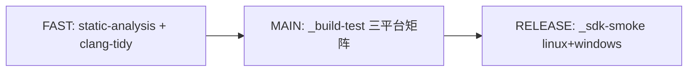

# CI/CD 与发布

<cite>
**Referenced Files**
- [ci.yml](file://.github/workflows/ci.yml)
- [release.yml](file://.github/workflows/release.yml)
- [deploy.yml](file://.github/workflows/deploy.yml)
- [_tag-gate.yml](file://.github/workflows/_tag-gate.yml)
</cite>

## 概览

`ci.yml` 是**唯一入口**（per-platform 工作流副本已删除，禁止重新引入），needs 串联三阶段：

| 主题 | 要点 | 详见 |
|------|------|------|
| CI 门禁 | 三阶段、三平台 DB 供给差异、九个守卫脚本、required check 命名契约 | [CI门禁与守卫脚本](CI门禁与守卫脚本) |
| 发布 | 四处版本声明、release.yml、tag 门禁（master 包含性 + 五 context 轮询） | [发布与版本治理](发布与版本治理) |
| 部署 | Docker Hub + AWS ECS 双环境、preflight 灰跳、RDS 快照回滚 | [部署流水线](部署流水线) |

## 两条贯穿性安全设计

1. **tag 从不被合并**：分支 ruleset 的 required checks 不覆盖 tag，所以 `_tag-gate.yml` 被 release.yml 与 deploy.yml 共同调用（`jobs.*.needs` 不能跨工作流），tag 未认证则两条流水线都拒绝出货。
2. **最小权限**：所有 action 钉 commit SHA；工作流级最小权限，仅 release publish 拿 write。

**Sources** · [ci.yml](file://.github/workflows/ci.yml) · [_tag-gate.yml](file://.github/workflows/_tag-gate.yml) · [AGENTS.md](file://AGENTS.md)
