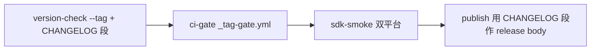

# 发布与版本治理

<cite>
**Referenced Files**
- [release.yml](file://.github/workflows/release.yml)
- [_tag-gate.yml](file://.github/workflows/_tag-gate.yml)
- [check_version_sync.py](file://scripts/check_version_sync.py)
- [version_sync_scenarios.py](file://scripts/ci/version_sync_scenarios.py)
- [tag_gate_scenarios.py](file://scripts/ci/tag_gate_scenarios.py)
</cite>

## 四处版本声明

版本只声明四次、从不推导：CMakeLists.txt project VERSION、conanfile.py version、examples/pay-admin/package.json 顶层 version、examples/pay-server/openapi.yaml info.version（契约向消费者发布版本，无人读的文档会写出从未发布的版本）。`check_version_sync.py` 强制一致：FAST 门无参跑要求四处一致；release 的 version-check 用 `--tag "$GITHUB_REF_NAME"` 加验 tag 相等与 CHANGELOG 段存在。

契约那一处**逐行扫描**（FAST 门 stdlib-only，不能 import YAML 解析器），每种拼写都是扫描器与解析器可能分歧的洞：`scripts/ci/version_sync_scenarios.py` 把 anchor/tag/alias/块标量/续行/缩进 junk/第二文档/tab/非 ASCII/换页符/前导零/未闭引号等形状钉成决策表，每个 PR 回放，并断言仓库自己契约读出的值属于一致集。

**Sources** · [check_version_sync.py](file://scripts/check_version_sync.py) · [version_sync_scenarios.py](file://scripts/ci/version_sync_scenarios.py)

## release.yml 流程（v* tag）

## _tag-gate.yml：tag 已认证的定义

tag 从不被合并，ruleset 的 required checks 不覆盖它（v1.0.0 曾带红 windows-build-and-test 发布）。门禁要求：

1. tag 形如 `v` + 三段数字（拒绝其它形状）；
2. tagged commit 已在 master 历史上（包含性）；
3. 轮询五个必需 context 全绿（同名取最大 check-run id）；DEADLINE 120 分钟；
4. 入口作业（static-analysis/clang-tidy）15 分钟未出现即早退——release 工作流自己也在 tagged commit 上报 check run，空列表证明不了什么，这两个名字出现才是 ci.yml 到达过的证据。

release.yml 与 deploy.yml 共用这一份定义（workflow_call）。注意局限：Actions 跑的是 **tagged commit 里存的定义**，指向早于门禁的旧 commit 的 tag 仍按旧文件构建——门禁向前关闭路径，不追溯。`scripts/ci/tag_gate_scenarios.py` 用 stand-in API 驱动工作流自身 run: 字节回放判定，改门禁前先跑它。

**Sources** · [_tag-gate.yml](file://.github/workflows/_tag-gate.yml) · [tag_gate_scenarios.py](file://scripts/ci/tag_gate_scenarios.py)

## 发布顺序

1. `[Unreleased]` 归档为日期版本段；
2. 同一提交改四处声明 + 已发布包引用（README 两份 + plugin_integration.md）；
3. PR 合并、CI 绿后打 tag（`git tag v1.2.3 && git push --tags`）；
4. 用 `/release` 技能 runbook，不手工建 release。

禁止在 config/部署注释里重述版本——那是检查器存在前的漂移源。

**Sources** · [CONTRIBUTING.md](file://CONTRIBUTING.md) · [SKILL.md](file://.claude/skills/release/SKILL.md)
