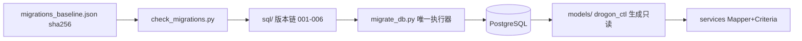

# 数据层

<cite>
**Referenced Files**
- [001_init_pay_tables.sql](file://sql/001_init_pay_tables.sql)
- [migrate_db.py](file://scripts/migrate_db.py)
- [check_migrations.py](file://scripts/check_migrations.py)
</cite>

## 概览

数据层由两部分组成：六表数据模型（含订单/支付/退款三条状态机）与迁移工程化（唯一执行器 + 不可变基线）。

| 主题 | 要点 | 详见 |
|------|------|------|
| 六表模型 | pay_order / pay_payment / pay_refund / pay_callback / pay_idempotency / pay_ledger | [数据模型与状态机](数据模型与状态机) |
| 状态机 | 订单 CREATED→PAYING→PAID→REFUNDED；支付 INIT→PROCESSING→SUCCESS/FAIL；退款三态 | 同上 |
| 迁移工程 | 唯一执行器、版本记账、sha256 不可变基线、幂等非破坏规则 | [数据库迁移工程](数据库迁移工程) |

## 关键约束

- **金额一律元单位十进制字符串**（VARCHAR(32)），禁分单位整数与 JSON number；
- **ORM 模型禁止手改**（drogon_ctl 生成）；`src/models_backup/` 是 gitignored 历史备份，非现役代码；
- **禁 raw SQL**：业务访问用 Mapper + Criteria 异步回调（动态条件用 SqlBinder 绑定）；
- **迁移文件不可变**：已发布迁移改字节会被执行器拒绝，基线由 check_migrations.py 守护。

**Sources** · [TECH_SPECS.md](file://TECH_SPECS.md) · [db-operations.md](file://.claude/rules/db-operations.md)
