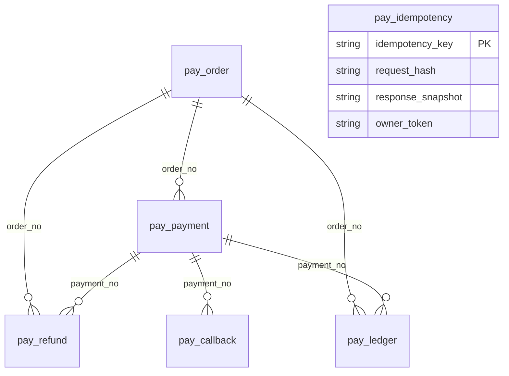
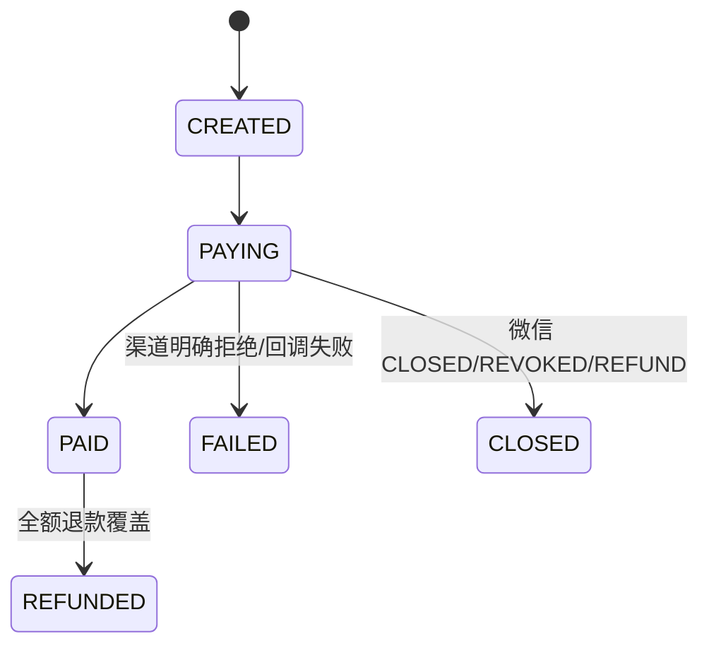

# 数据模型与状态机

<cite>
**Referenced Files**
- [001_init_pay_tables.sql](file://sql/001_init_pay_tables.sql)
- [003_refund_unique_constraint.sql](file://sql/003_refund_unique_constraint.sql)
- [006_ledger_payment_income_unique.sql](file://sql/006_ledger_payment_income_unique.sql)
- [TECH_SPECS.md](file://TECH_SPECS.md)
</cite>

## 六表模型

sql/001 建 6 表（金额一律 VARCHAR 字符串；4 张有 updated_at 的表由 plpgsql 触发器自动刷新时间戳）：

| 表 | 用途 | 关键约束 |
|----|------|----------|
| pay_order | 订单 | order_no UNIQUE |
| pay_payment | 支付尝试（一次尝试一行） | payment_no UNIQUE，order_no 非唯一 |
| pay_refund | 退款 | refund_no UNIQUE + (order_no,payment_no,refund_no) 复合唯一 |
| pay_callback | 回调审计 | verified/processed 布尔 |
| pay_idempotency | 幂等键 | key 主键 + request_hash + response_snapshot + owner_token |
| pay_ledger | append-only 台账 | 无 updated_at；PAYMENT 收入分录部分唯一索引（sql/006，一笔支付至多一条收入；REFUND 故意不受限） |

ORM 模型在 `libs/drogon-pay/src/models/`（drogon_ctl 生成，禁止手改）；`src/models_backup/` 是 gitignored 历史备份，非现役代码。

**Sources** · [001_init_pay_tables.sql](file://sql/001_init_pay_tables.sql) · [006_ledger_payment_income_unique.sql](file://sql/006_ledger_payment_income_unique.sql)

## 状态机

订单（两条创建路径共用 CREATED 起点）：

- 支付尝试行：`INIT → PROCESSING → SUCCESS / FAIL`；
- 退款：`REFUND_INIT → REFUNDING → REFUND_SUCCESS / REFUND_FAIL`。

## 词汇分表（重要）

订单表终态失败拼写 **FAILED**，支付表为 **FAIL**。支付宝 TRADE_CLOSED 的支付行曾误写 FAILED，已修复为 FAIL（PaymentService.cc:2923-2929 注释在案）。TECH_SPECS「已知缺陷」段落描述的是修复前状态，属过时口径。消费端查询必须按表选词。

## 不确定尝试不置终态

超时/传输错误/无 code_url 的尝试**不置终态**，由回调或对账收敛——这是判死规则（attemptCertainlyNotCreated / refundCertainlyDidNotHappen）的数据层体现。

**Sources** · [PaymentService.cc:2923-2929](file://libs/drogon-pay/src/services/PaymentService.cc#L2923-L2929) · [TECH_SPECS.md](file://TECH_SPECS.md)
