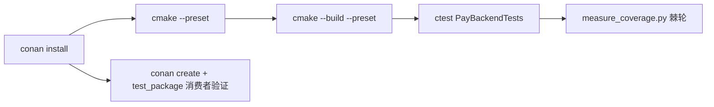

# 构建与测试

<cite>
**Referenced Files**
- [conanfile.py](file://conanfile.py)
- [CMakePresets.json](file://CMakePresets.json)
- [measure_coverage.py](file://scripts/measure_coverage.py)
</cite>

## 概览

构建体系是 Conan 2 + CMakePresets；测试体系是 Drogon DROGON_TEST（非 gtest）+ gcov 覆盖率棘轮。



| 主题 | 要点 | 详见 |
|------|------|------|
| 构建 | 7 个 preset、孪生入口脚本、静态库打包、find_package 导出 | [构建体系](构建体系) |
| 测试 | 单入口 246 用例、unit/integration 布局守卫、StubChannel、覆盖率棘轮 | [测试体系](测试体系) |

## 快速命令

```bash
# Linux/macOS
examples/pay-server/scripts/build.sh          # Release；-debug 切 debug preset
examples/pay-server/scripts/test.sh
# Windows（逐参数孪生）
examples\pay-server\scripts\build.bat
examples\pay-server\scripts\test.bat
# 消费者验证
conan create . --build=missing -s build_type=Release -s compiler.cppstd=17
```

集成测试需 Postgres + Redis（127.0.0.1，test 角色 / pay_test 库）。注意 WSL 陷阱：本机 WSL NAT 自带无 test 角色的 Postgres，ctest 会挂在 DB 认证而非失败，勿当代码缺陷排查。

**Sources** · [AGENTS.md](file://AGENTS.md) · [CONTRIBUTING.md](file://CONTRIBUTING.md)
