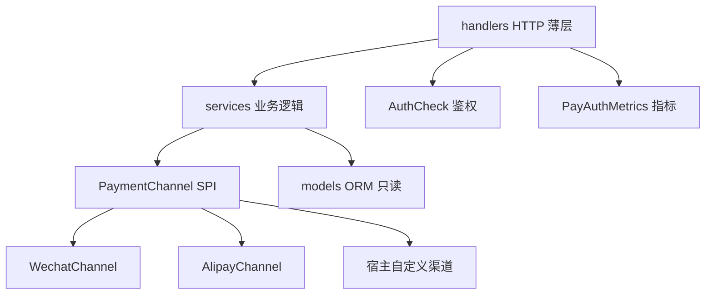

# 架构设计

<cite>
**Referenced Files**
- [PayPlugin.cc](file://libs/drogon-pay/src/PayPlugin.cc)
- [ChannelRegistry.cc](file://libs/drogon-pay/src/ChannelRegistry.cc)
- [PaymentChannel.h](file://libs/drogon-pay/include/drogon_pay/PaymentChannel.h)
- [check_architecture.py](file://scripts/check_architecture.py)
</cite>

## 总体架构

drogon-pay 采用单向分层：`handlers → services → channels → models`。HTTP 薄层只做鉴权、参数解析与错误映射；业务逻辑全部在服务层；服务层只面向 `PaymentChannel` SPI 编程，不感知具体渠道；ORM 模型只读（drogon_ctl 生成）。

## 四个设计支柱

| 支柱 | 机制 | 详见 |
|------|------|------|
| 依赖方向 | 四条架构守卫规则，CI 强制 | [分层架构与依赖守卫](分层架构与依赖守卫) |
| 装配确定性 | initAndStart 固定顺序，启动失败语义明确 | [插件装配与生命周期](插件装配与生命周期) |
| 渠道可插拔 | SPI 契约 + 注册中心启动期冻结 | [渠道SPI与注册中心](渠道SPI与注册中心) |
| 最小 API 面 | 公共头冻结为 4 个，白名单守卫 | 下文 |

## 公共 API 面（冻结）

`libs/drogon-pay/include/drogon_pay/` 只允许 4 个头文件：

1. `PayPlugin.h` — 插件入口与生命周期
2. `PaymentChannel.h` — 渠道 SPI 与 CallbackEvent
3. `ChannelRegistry.h` — 注册中心与宿主 registerFactory
4. `PayErrorCategory.h` — 错误码分类

新增公共头必须在同一 PR 修改 `scripts/check_architecture.py` 的白名单——刻意摩擦，保持 API 面小。`PayPlugin::alipayClient()` 是 SPI 白名单的唯一例外（支付宝回调路径需要具体客户端验签）。

**Sources** · [check_architecture.py](file://scripts/check_architecture.py) · [PayPlugin.h](file://libs/drogon-pay/include/drogon_pay/PayPlugin.h)

## 关键架构决策

- **路由程序化注册**：全部用 `app.registerHandler`，不用 `ADD_METHOD_TO` 静态注册——静态库链接会丢自注册符号。`drogon_pay::ensureLinked()` 是同类问题的公共 API 保险。
- **异常屏障**：guarded 包装用 atomic CAS 保证只响应一次；handler 响应前抛异常才回 500，防 trantor 重抛崩进程。
- **专用 worker 线程**：对账与证书刷新定时器跑在插件自己的 `EventLoopThread("PayPluginWorker")`，不占用宿主 IO 线程。
- **无隐式兜底**：未知渠道 find 返回 nullptr，调用方必须映射 `CHANNEL_NOT_AVAILABLE`。

**Sources** · [PayPlugin.cc:53-106](file://libs/drogon-pay/src/PayPlugin.cc#L53-L106) · [ChannelRegistry.cc](file://libs/drogon-pay/src/ChannelRegistry.cc)
