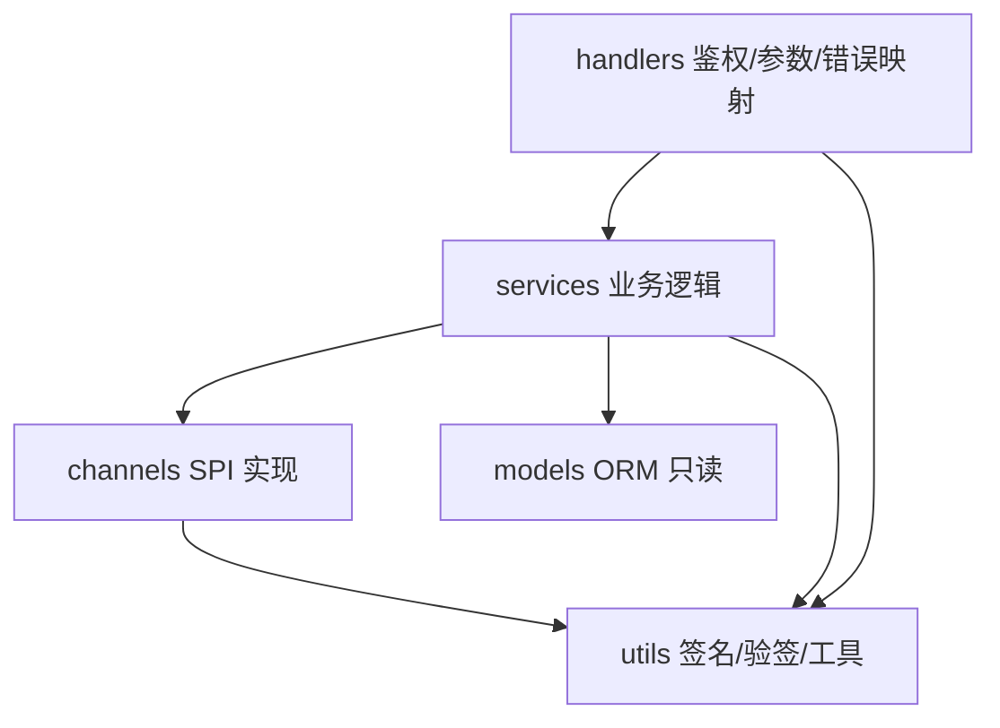

# 分层架构与依赖守卫

<cite>
**Referenced Files**
- [check_architecture.py](file://scripts/check_architecture.py)
- [PayPlugin.cc](file://libs/drogon-pay/src/PayPlugin.cc)
- [TECH_SPECS.md](file://TECH_SPECS.md)
</cite>

## 分层与依赖方向

库内五层，依赖严格单向：



| 层 | 职责 | 禁止 |
|----|------|------|
| handlers | HTTP 薄层：AuthCheck、参数解析、错误码→HTTP 映射、能力型 dynamic_pointer_cast | 写业务逻辑 |
| services | 事务、状态机、幂等、对账 | include 具体渠道头 |
| channels | 渠道协议实现（签名/验签/加解密） | 反向依赖 services |
| models | drogon_ctl 生成的 ORM | 手改（CI 禁止） |
| utils | 无状态工具（PayUtils 等） | 持有业务状态 |

## 四条守卫规则（CI 强制）

`scripts/check_architecture.py` 在 FAST 门禁逐条扫描 include 关系：

1. **库不依赖宿主**：`libs/drogon-pay/src/**` 不得 include `examples/` 任何内容。
2. **公共头不泄漏实现**：`include/drogon_pay/**` 不得 include 内部 `src/` 头。
3. **服务只面向 SPI**：`src/services/**` 不得 include `src/channels/**` 具体渠道头；渠道独有能力通过 handlers 层 `dynamic_pointer_cast` 访问。
4. **API 面冻结**：公共头白名单仅 4 个（PayPlugin.h / PaymentChannel.h / ChannelRegistry.h / PayErrorCategory.h），新增必须同 PR 改白名单。

## 唯一例外：alipayClient()

支付宝回调不经 CallbackService，handlers 需要具体客户端验签，因此 `PayPlugin::alipayClient()` 是 SPI 白名单的唯一例外（守卫脚本显式放行）。微信路径无此例外：CallbackService 通过 SPI 的 `verifyCallback` 完成验签。

**Sources** · [check_architecture.py](file://scripts/check_architecture.py) · [CallbackHandlers.cc:197-306](file://libs/drogon-pay/src/handlers/CallbackHandlers.cc#L197-L306)

## 违规后果与本地运行

守卫是硬门禁：任一规则违反即 CI 失败，无法合并。本地推送前运行：

```bash
python scripts/check_architecture.py
```

新增渠道时的正确姿势：实现 SPI → 宿主 registerFactory 注册（不改库）；确需进库则走 CONTRIBUTING 的渠道准入清单（线程安全、HttpClient 复用、verifyCallback 归一化、registerBuiltinChannels 显式注册、集成测试）。

**Sources** · [CONTRIBUTING.md](file://CONTRIBUTING.md) · [plugin_integration.md](file://docs/development/plugin_integration.md)
