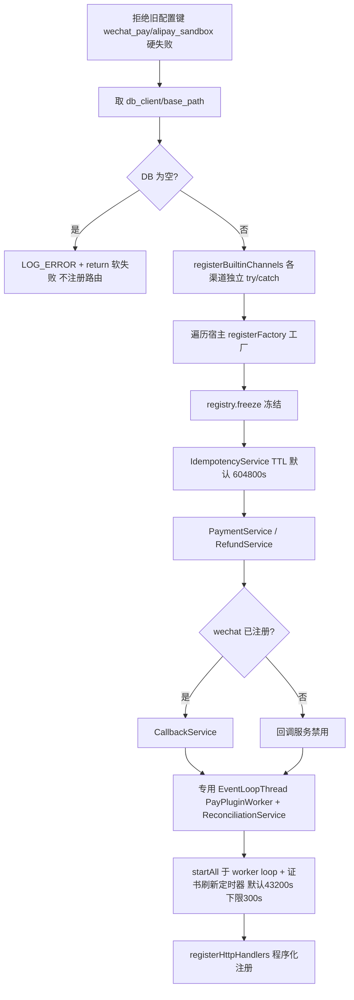

# 插件装配与生命周期

<cite>
**Referenced Files**
- [PayPlugin.cc](file://libs/drogon-pay/src/PayPlugin.cc)
- [ChannelRegistry.cc](file://libs/drogon-pay/src/ChannelRegistry.cc)
- [PluginGuard.h](file://libs/drogon-pay/src/handlers/PluginGuard.h)
</cite>

## initAndStart 装配顺序

`PayPlugin::initAndStart`（PayPlugin.cc:152-325）按固定顺序装配，每一步的失败语义都明确：

## 失败语义

| 场景 | 行为 | 理由 |
|------|------|------|
| 旧配置键（wechat_pay/alipay_sandbox） | 硬失败，拒绝启动 | 旧键已被插件块取代，静默忽略会造成配置事故 |
| db_client 缺失 | LOG_ERROR + return，不注册路由 | 软失败：宿主其余功能可用，支付路由统一 503 |
| 单个渠道构造失败 | 独立 try/catch，其余渠道照常 | 渠道间故障隔离 |
| 插件未就绪时请求 | respondPluginUnavailable：code 1501 + HTTP 503 | fail-closed，不猜测 |

**Sources** · [PayPlugin.cc:152-325](file://libs/drogon-pay/src/PayPlugin.cc#L152-L325) · [PluginGuard.h:29-42](file://libs/drogon-pay/src/handlers/PluginGuard.h#L29-L42)

## 冻结机制（ChannelRegistry）

- 工厂表用**函数内静态**避免静态初始化顺序问题（SIOF）。
- `freeze()` 后 `add` 一律忽略：启动期之后渠道集合不可变。
- `find` 运行期**无锁查表**；未知渠道返回 nullptr，调用方必须映射 `CHANNEL_NOT_AVAILABLE`，无隐式兜底。
- 内置渠道在 `registerBuiltinChannels()` 显式注册——不用自注册宏，静态库构建会丢那些符号。

**Sources** · [ChannelRegistry.cc](file://libs/drogon-pay/src/ChannelRegistry.cc)

## 异常屏障与单次响应

`PayPlugin.cc:53-106` 的 guarded 包装：

- atomic CAS 保证回调只响应一次（渠道回调与超时竞态时不双发）；
- handler 在响应前抛异常才回 500；响应后异常不再触 trantor 重抛，避免崩进程。

## shutdown

停止对账与证书刷新定时器、停 worker 线程、渠道 onStop。回调按值捕获服务指针防 teardown 悬垂（对账 sweep 同策略）。

**Sources** · [PayPlugin.cc:53-106](file://libs/drogon-pay/src/PayPlugin.cc#L53-L106) · [ReconciliationService.cc](file://libs/drogon-pay/src/services/ReconciliationService.cc)
