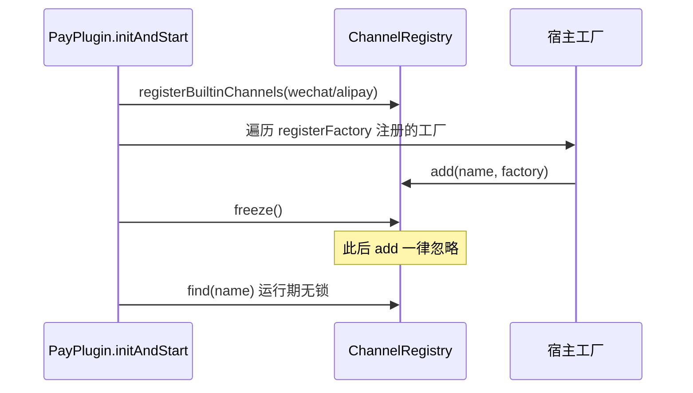

# 渠道 SPI 与注册中心

<cite>
**Referenced Files**
- [PaymentChannel.h](file://libs/drogon-pay/include/drogon_pay/PaymentChannel.h)
- [ChannelRegistry.h](file://libs/drogon-pay/include/drogon_pay/ChannelRegistry.h)
- [ChannelRegistry.cc](file://libs/drogon-pay/src/ChannelRegistry.cc)
- [plugin_integration.md](file://docs/development/plugin_integration.md)
</cite>

## SPI 契约

`PaymentChannel.h:36-111` 定义的接口契约：

- **线程安全**：所有方法可能被 Drogon IO 线程并发调用；
- **连接复用**：出站 HTTP 必须复用 keep-alive 客户端（每事件循环一个，见 HttpClientPool）；
- **回调归一化**：`verifyCallback` 把渠道原始通知转为 `CallbackEvent`（paid / amountTotal 分 / rawPayload）。

方法集：

| 方法 | 说明 |
|------|------|
| `name` / `isConfigured` | 渠道标识与就绪性 |
| `createPayment` / `createQRPayment` | 下单 / 扫码下单 |
| `queryPayment` / `closeOrder` | 查单 / 关单（默认不支持） |
| `refund` / `queryRefund` | 退款 / 查退款 |
| `verifyCallback` | 验签并归一化回调 |
| `onStart` / `onStop` | 生命周期钩子（worker loop 上调用） |

**非对称能力留在具体类**：渠道独有能力不进 SPI（避免 SPI 膨胀），调用点在 handlers 层 `dynamic_pointer_cast`。

**Sources** · [PaymentChannel.h:36-111](file://libs/drogon-pay/include/drogon_pay/PaymentChannel.h#L36-L111)

## 注册中心：启动期注册、冻结、无锁查找

- 工厂表用函数内静态避免 SIOF；
- `freeze()` 后渠道集合不可变，运行期 `find` 无锁；
- 未知渠道返回 nullptr → 调用方映射 `CHANNEL_NOT_AVAILABLE`，无隐式兜底。

**Sources** · [ChannelRegistry.cc](file://libs/drogon-pay/src/ChannelRegistry.cc) · [ChannelRegistry.h](file://libs/drogon-pay/include/drogon_pay/ChannelRegistry.h)

## 宿主自定义渠道

新渠道通常是**宿主侧插件，不是库修改**：

1. 实现 `drogon_pay::PaymentChannel`（满足线程安全/连接复用/归一化三契约）；
2. 通过 `ChannelRegistry::registerFactory` 注册工厂；
3. config.json 启用渠道配置。

进库（`src/channels/`）的额外门槛：集成测试、`registerBuiltinChannels()` 显式注册（禁自注册宏）、不得打真实支付端点。完整指南见 plugin_integration.md「自定义渠道开发指南」。

**Sources** · [plugin_integration.md](file://docs/development/plugin_integration.md) · [CONTRIBUTING.md](file://CONTRIBUTING.md)
