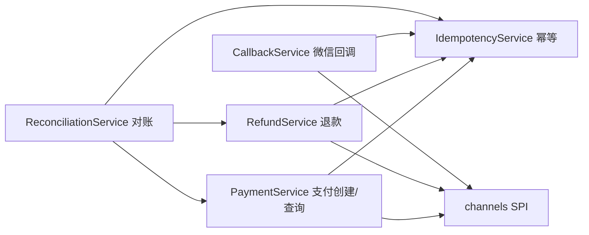

# 核心业务模块

<cite>
**Referenced Files**
- [PaymentService.cc](file://libs/drogon-pay/src/services/PaymentService.cc)
- [RefundService.cc](file://libs/drogon-pay/src/services/RefundService.cc)
- [CallbackService.cc](file://libs/drogon-pay/src/services/CallbackService.cc)
- [IdempotencyService.cc](file://libs/drogon-pay/src/services/IdempotencyService.cc)
- [ReconciliationService.cc](file://libs/drogon-pay/src/services/ReconciliationService.cc)
</cite>

## 模块总览

五大服务 + 两个内置渠道，全部位于 `libs/drogon-pay/src/`：

| 模块 | 规模 | 核心设计规则 | 详见 |
|------|------|--------------|------|
| PaymentService | 约 3800 行 | 事务先落库再调渠道；列级 CAS；不确定尝试不置终态 | [支付创建与查询](支付创建与查询) |
| RefundService | — | FOR UPDATE 超退防护；确定未发生才记失败 | [退款处理](退款处理) |
| CallbackService | 约 3850 行 | 仅微信；四闸门 + owner_token + COMMIT 后 ACK | [回调处理与验签](回调处理与验签) |
| IdempotencyService | 约 410 行 | DB 唯一真相源；五态语义；快照先于响应 | [幂等机制](幂等机制) |
| ReconciliationService | 约 410 行 | 专用 worker；三路 sweep + GC | [对账服务](对账服务) |
| WechatChannel / AlipayChannel | — | V3 签名/应答验签 vs RSA2/沙箱 | [内置支付渠道](内置支付渠道) |

## 贯穿性设计规则

1. **先落库后调渠道**：创建/退款都是显式 COMMIT 后才发起出站请求，渠道结果不确定时由回调/对账收敛，绝不把在途交易置终态。
2. **幂等快照先于响应**：调用方保证 `updateResult` 落盘后才返回客户端，重试才能命中 Replay。
3. **状态推进用 CAS**：列级条件更新防止快回调/对账回滚已结算状态。
4. **金额元单位字符串**：全链路 `^\d+(\.\d{1,2})?$`，落库 VARCHAR(32)，禁分单位整数与 JSON number；渠道边界做分↔元转换。
5. **回调 ACK 在 COMMIT 之后**：微信路径事务提交成功才应答 SUCCESS，否则 FAIL 让渠道重试。

**Sources** · [TECH_SPECS.md](file://TECH_SPECS.md) · [2026-11-12-project-deep-analysis.md](file://docs/review/2026-11-12-project-deep-analysis.md)
