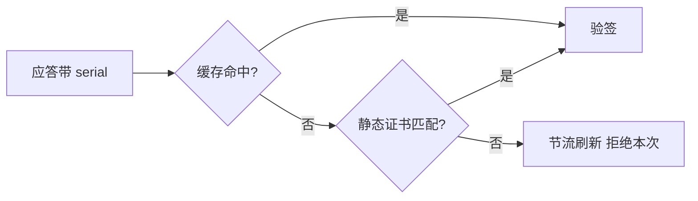

# 内置支付渠道

<cite>
**Referenced Files**
- [WechatChannel.h](file://libs/drogon-pay/src/channels/WechatChannel.h)
- [HttpClientPool.h](file://libs/drogon-pay/src/channels/HttpClientPool.h)
- [PayUtils.cc](file://libs/drogon-pay/src/utils/PayUtils.cc)
</cite>

## 实现对比

| 维度 | WechatChannel | AlipayChannel |
|------|---------------|---------------|
| 下单 | native `/v3/pay/transactions/native`（createPayment=createQRPayment） | trade.create / trade.precreate（沙箱网关默认 alipaydev） |
| 签名 | WECHATPAY2-SHA256-RSA2048（method\nurl\nts\nnonce\nbody） | RSA2 = SHA256withRSA，参数字典序签名串 |
| 应答验签 | **覆盖所有响应**含 204 与非 2xx 错误信封；失败丢弃 body（仅证书下载豁免，自证 AES-GCM） | **无应答验签**（关键不对称） |
| 回调验签 | 平台证书 + 时间戳±300s + AES-256-GCM 解密 | RSA2 验签排除 sign/sign_type 且跳过空值 |
| 金额单位 | 全程分 | 元字符串（服务层整数运算分↔元） |
| 默认超时 | 5s | 30s |
| 证书/密钥 | 平台证书 shared_mutex map + 定时热刷新 + 下载节流；setPlatformCert 四重校验 | 私钥构造期一次性加载防 TOCTOU |

**Sources** · [WechatChannel.h](file://libs/drogon-pay/src/channels/WechatChannel.h) · [PayUtils.cc](file://libs/drogon-pay/src/utils/PayUtils.cc)

## HttpClient 复用（纠正旧口径）

`HttpClientPool.h:22-36` 是 **`thread_local unordered_map<host, HttpClient>`**——每事件循环一个 keep-alive 客户端，非 IO 线程回退 app 主 loop。注释明言「等价 IOThreadStorage 但测试主线程可用」，**并非真用 `drogon::IOThreadStorage`**（README/architecture_overview 的旧口径已列入差异清单）。

**Sources** · [HttpClientPool.h:22-36](file://libs/drogon-pay/src/channels/HttpClientPool.h#L22-L36)

## 微信平台证书热刷新

- 缓存是 **shared_mutex 保护的 serial→X509 map**（WechatChannel.h:139-140），不是原子 shared_ptr 快照；
- 刷新定时器默认 43200s、下限 300s（下载节流）；
- 未知 serial → 查缓存 → 静态证书按 serial 匹配 → 节流刷新并拒绝本次；
- `onStart` 预热；`answerVerifier` weak_ptr 防销毁竞态。

**Sources** · [WechatChannel.h:139-140](file://libs/drogon-pay/src/channels/WechatChannel.h#L139-L140)

## 状态映射与工具

`PayUtils.cc` 提供 `mapTradeState:418-453`（渠道状态→本地状态）与 `validateNotifyUrl:498-528`（SSRF 防护：按地址形状拦截私网/环回/链路本地；DNS rebinding 为已知局限）。

**Sources** · [PayUtils.cc:418-528](file://libs/drogon-pay/src/utils/PayUtils.cc#L418-L528)
