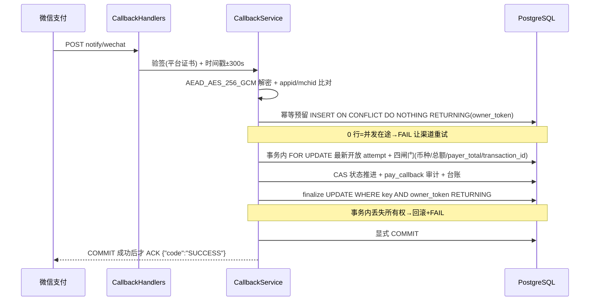

# 回调处理与验签

<cite>
**Referenced Files**
- [CallbackService.cc](file://libs/drogon-pay/src/services/CallbackService.cc)
- [CallbackHandlers.cc](file://libs/drogon-pay/src/handlers/CallbackHandlers.cc)
- [005_pay_idempotency_owner_token.sql](file://sql/005_pay_idempotency_owner_token.sql)
</cite>

## 职责划分（重要口径）

**CallbackService 只处理微信回调**。支付宝回调由 `CallbackHandlers.cc:197-306` 直接调 `alipayClient->verifyCallback` 验签（先于任何改库）、复核 app_id、组装 code=10000 结果后走 `PaymentService::syncOrderStatusFromAlipay`。旧文档把 handleAlipayCallback 归入 CallbackService 是过时口径。

## 微信支付回调全链路

**Sources** · [CallbackService.cc:1499-1543](file://libs/drogon-pay/src/services/CallbackService.cc#L1499-L1543)

## 防重放

`checkNonce`（:285-332）：Redis SET NX EX 360；无 Redis/出错 **fail-open**，DB 幂等表兜底——正确性不依赖 Redis。

## owner_token 两阶段预留（属 CallbackService）

sql/005 给 pay_idempotency 加 owner_token 列：

- 预留时写入随机 32 位 token（:749-768）；
- 读到 NULL 快照→删除陈旧预留+FAIL；
- finalize（:131-157）以 `UPDATE … WHERE key AND owner_token RETURNING` 守卫：事务内丢失所有权即回滚不 ACK；提交后丢失所有权仅告警仍 ACK。

注意：owner_token 是**微信回调路径**的机制，不属于 IdempotencyService 的通用 API。

**Sources** · [CallbackService.cc:285-332](file://libs/drogon-pay/src/services/CallbackService.cc#L285-L332) · [CallbackService.cc:749-768](file://libs/drogon-pay/src/services/CallbackService.cc#L749-L768) · [005_pay_idempotency_owner_token.sql](file://sql/005_pay_idempotency_owner_token.sql)

## 边界情形

- 已终态直接 ACK；REFUNDED 声明按已结算退款 SUM 降级为 PAID；
- CAS 空集→回滚 + 主客户端补审计行 + ACK；
- 退款回调（REFUND.* 事件）同套 finalize/COMMIT 时序，REFUND_SUCCESS 写 REFUND 台账。

## 支付宝路径与已知风险

支付宝验签排除 sign/sign_type 且跳过空值；成功应答目前返回 JSON 而非渠道约定的纯文本 `success`（CallbackHandlers.cc:336-340）——支付宝可能视为失败重复通知，幂等与 owner_token 兜底正确性，但产生额外流量与告警噪音。另支付宝**无应答验签**（出站响应不验签），与微信不对称。

**Sources** · [CallbackHandlers.cc:197-340](file://libs/drogon-pay/src/handlers/CallbackHandlers.cc#L197-L340)
