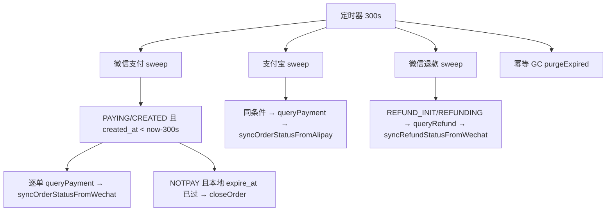

# 对账服务

<cite>
**Referenced Files**
- [ReconciliationService.cc](file://libs/drogon-pay/src/services/ReconciliationService.cc)
- [PayPlugin.cc](file://libs/drogon-pay/src/PayPlugin.cc)
- [PaymentService.cc](file://libs/drogon-pay/src/services/PaymentService.cc)
</cite>

## 运行载体

ReconciliationService（约 410 行）的定时器跑在 PayPlugin 专用 `EventLoopThread("PayPluginWorker")`，不占用宿主 IO 线程；微信平台证书刷新定时器同 loop。默认周期 **300s**、批量 **50**（config 的 reconcile.interval_seconds / batch_size 可调，reconcile.enabled 可关）。

**Sources** · [ReconciliationService.cc](file://libs/drogon-pay/src/services/ReconciliationService.cc) · [PayPlugin.cc:152-325](file://libs/drogon-pay/src/PayPlugin.cc#L152-L325)

## 每轮三路 sweep + 幂等 GC

要点：

- **只收敛在途**：sweep 对象是结果不确定的尝试（超时/传输错误留在途的那些），与「判死规则」互补；
- **关单规则**：微信 NOTPAY 且本地 expire_at 已过才 closeOrder，避免关掉用户仍可支付的单；
- **退款 sweep 仅微信**：支付宝退款状态由查询路径同步；
- 回调**按值捕获服务指针**防 teardown 悬垂；计数的是派发而非完成。

**Sources** · [ReconciliationService.cc](file://libs/drogon-pay/src/services/ReconciliationService.cc)

## 对账报表

`PaymentService::reconcileSummary`（GET base/reconcile/summary，需 scope `reconcile`）：PAYING 订单数 + 最老 updated_at、退款中计数。pay-admin 的「对账与指标」页轮询此接口。

**Sources** · [PaymentService.cc](file://libs/drogon-pay/src/services/PaymentService.cc) · [PayPlugin.cc:357-417](file://libs/drogon-pay/src/PayPlugin.cc#L357-L417)
