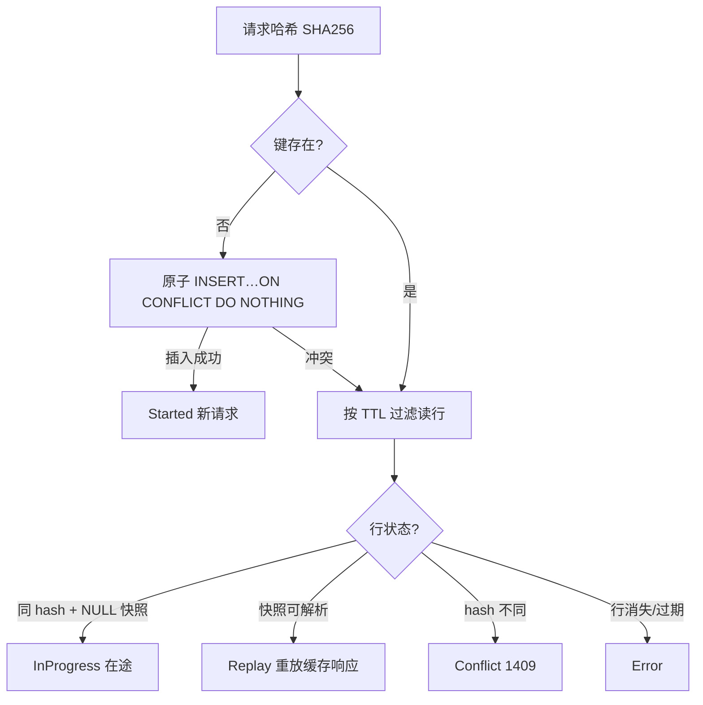

# 幂等机制

<cite>
**Referenced Files**
- [IdempotencyService.cc](file://libs/drogon-pay/src/services/IdempotencyService.cc)
- [001_init_pay_tables.sql](file://sql/001_init_pay_tables.sql)
- [005_pay_idempotency_owner_token.sql](file://sql/005_pay_idempotency_owner_token.sql)
</cite>

## 真相源：数据库，不是 Redis

**DB 是唯一真相源；Redis 读穿透被刻意禁用**（IdempotencyService.cc:65-69 注释：直到 Redis 能共享同一套 Started/Replay/InProgress/Conflict 契约）。仅 `updateResult` 成功后 SETEX 写穿透，Redis 错误忽略。旧文档「Redis 优先、数据库兜底」是错误口径。

实际 API：`checkAndSet` / `checkAndSetStatus` / `updateResult` / `clearReservation` / `purgeExpired`（TECH_SPECS 旧方法名 checkIdempotency 等已过时）。

**Sources** · [IdempotencyService.cc:65-69](file://libs/drogon-pay/src/services/IdempotencyService.cc#L65-L69)

## 五态语义（checkAndSetStatus）

TTL 默认 604800s（7 天，可配 idempotency_ttl_seconds）。

## 预留清理与 GC

- `clearReservation` 只删 NULL 快照行（不碰已完成快照）；参数校验失败时调用；
- `purgeExpired` 服务端 NOW() GC，由对账 worker 每轮附带执行。

## 快照先于响应（调用方保证）

幂等服务本身不控制响应时序；**调用方**必须在 `updateResult` 落盘后才返回客户端：

- PaymentService.cc:1553-1585；
- RefundService.cc:255-300。

否则重试请求会读到 NULL 快照而报 InProgress，而不是命中 Replay——这是曾经修复过的真实缺陷。

**Sources** · [PaymentService.cc:1553-1585](file://libs/drogon-pay/src/services/PaymentService.cc#L1553-L1585) · [RefundService.cc:255-300](file://libs/drogon-pay/src/services/RefundService.cc#L255-L300)

## owner_token 的归属

pay_idempotency.owner_token（sql/005）服务于**微信回调的两阶段预留**，由 CallbackService 写入与守卫，不是 IdempotencyService 通用 API 的一部分。详见「回调处理与验签」。

**Sources** · [005_pay_idempotency_owner_token.sql](file://sql/005_pay_idempotency_owner_token.sql) · [CallbackService.cc:749-768](file://libs/drogon-pay/src/services/CallbackService.cc#L749-L768)
