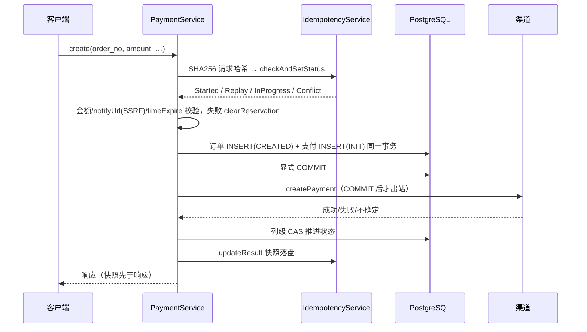

# 支付创建与查询

<cite>
**Referenced Files**
- [PaymentService.cc](file://libs/drogon-pay/src/services/PaymentService.cc)
- [PayUtils.cc](file://libs/drogon-pay/src/utils/PayUtils.cc)
- [TECH_SPECS.md](file://TECH_SPECS.md)
</cite>

## create 路径（事务时序）

`createPayment:486` → `proceedCreatePayment:716`：

关键时序（PaymentService.cc:837-903）：**订单与支付行同一事务插入，显式 COMMIT 后才调渠道**。渠道成功用列级 CAS（:1108-1144）：支付行仅 INIT/PROCESSING→PROCESSING，订单行仅 CREATED/PAYING→PAYING——防止慢出站回滚快回调已结算的状态。

**Sources** · [PaymentService.cc:486-903](file://libs/drogon-pay/src/services/PaymentService.cc#L486-L903)

## qrpay 路径差异

`createQRPayment:1265`：

- JSON 入参；幂等键可派生 `QR_<orderNo>_<channel>`；强制 user_id>0；
- **无事务**：先探测复用订单（PAID/SUCCESS/REFUNDED 拒绝、金额按分比较、币种/渠道/属主一致），再查已结算支付行拒绝二次出码；
- 顺序 insertQrOrder → bookQrPayment(INIT) → offerQrChannel；
- `pay_payment.order_no` 非唯一键：一次尝试追加一行，`promoteQrRows:1590` 只选最新「可承载资金」attempt，PAID 前有双重金额闸门。

**Sources** · [PaymentService.cc:1265-1695](file://libs/drogon-pay/src/services/PaymentService.cc#L1265-L1695)

## 判死规则（两路径共用）

`attemptCertainlyNotCreated:327`：

| 渠道结果 | 处置 |
|----------|------|
| 渠道错误信封 / 带信封 HTTP 4xx / 本地故障 | 可判死（置终态） |
| 超时 / 无信封 4xx / 2xx 无码 | **留在途**，等回调或对账收敛 |

理由：把结果不确定的尝试置终态，等于让用户仍能支付的一笔交易从所有恢复视角里消失。`markQrPaymentFailed:1695` 只关支付行不动订单（旧码可能仍有效）。

**Sources** · [PaymentService.cc:327-400](file://libs/drogon-pay/src/services/PaymentService.cc#L327-L400)

## 查询与列表

- `queryOrder:2134`：先 DB 再渠道实时查询；渠道失败降级 code=1 附 `*_query_error`，不报错。
- `queryOrderList:3658`：参数化 LEFT JOIN，limit 钳制 [1,100] 默认 50。
- 支付宝 `TRADE_CLOSED` 映射：订单 FAILED、支付 **FAIL**（:2923-2929，修复过 FAILED 拼写导致 FAIL 查询漏行；词汇分表见「数据模型与状态机」）。

**Sources** · [PaymentService.cc:2134-2929](file://libs/drogon-pay/src/services/PaymentService.cc#L2134-L2929) · [PaymentService.cc:3658-3800](file://libs/drogon-pay/src/services/PaymentService.cc#L3658-L3800)
