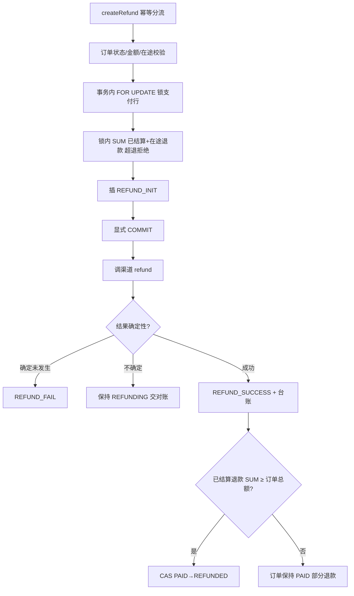

# 退款处理

<cite>
**Referenced Files**
- [RefundService.cc](file://libs/drogon-pay/src/services/RefundService.cc)
- [003_refund_unique_constraint.sql](file://sql/003_refund_unique_constraint.sql)
- [PayUtils.cc](file://libs/drogon-pay/src/utils/PayUtils.cc)
</cite>

## 流程链

`createRefund:229` → `proceedRefund:389` → 订单流/金额校验/在途检查 → `proceedWithInsert:938` → `invokeRefundChannel:1272`。

## 超退防护（双层）

1. **应用层**：事务内 `FOR UPDATE` 锁支付行（:1003）→ 锁内 SUM(REFUND_INIT/REFUNDING/REFUND_SUCCESS) 超退拒绝（:1038-1087）→ 插 REFUND_INIT → 显式 COMMIT 后调渠道。
2. **DB 层纵深防御**：`(order_no, payment_no, refund_no)` 复合唯一索引（sql/003）。

**Sources** · [RefundService.cc:938-1087](file://libs/drogon-pay/src/services/RefundService.cc#L938-L1087) · [003_refund_unique_constraint.sql](file://sql/003_refund_unique_constraint.sql)

## refundCertainlyDidNotHappen（:58-71）

| 渠道结果 | 处置 |
|----------|------|
| 本地故障 / 带错误信封的 HTTP 4xx | 记 REFUND_FAIL |
| 5xx / 超时 / 无信封 4xx / 验签失败 | 保持 REFUNDING 交对账 |

理由：防止换 out_refund_no 重试造成**二次退款**——结果不确定时绝不置失败终态。

**Sources** · [RefundService.cc:58-71](file://libs/drogon-pay/src/services/RefundService.cc#L58-L71)

## 部分退款与父订单 REFUNDED

仅当 REFUND_SUCCESS 且已结算退款 SUM ≥ 订单总额才 CAS PAID→REFUNDED（:1700-1750）；部分退款订单保持 PAID（微信单笔订单最多 50 次部分退款）。

## 幂等与快照时序

- 同额已成功退款直接幂等返回；同额在途计数>0 报 1409；
- **快照先于响应**（RefundService.cc:255-300）；
- 软错误（1502 带 data）仍缓存快照、硬错误清预留。

**Sources** · [RefundService.cc:1700-1750](file://libs/drogon-pay/src/services/RefundService.cc#L1700-L1750) · [RefundService.cc:255-300](file://libs/drogon-pay/src/services/RefundService.cc#L255-L300)
