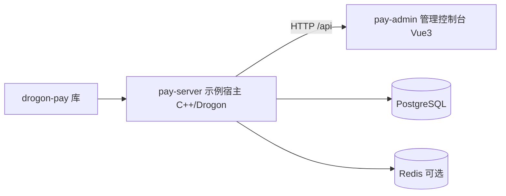

# 示例应用

<cite>
**Referenced Files**
- [main.cc](file://examples/pay-server/main.cc)
- [config.json](file://examples/pay-server/config.json)
- [package.json](file://examples/pay-admin/package.json)
</cite>

## 职责边界

`examples/` 下两个独立示例模块，**都不进 Conan 包**：

| 模块 | 职责 | 不属于插件的关注点 |
|------|------|--------------------|
| pay-server | 演示宿主集成：启动校验、配置、部署资产 | 密钥管理、CORS/安全头、健康探针、指标聚合、限流、运维 |
| pay-admin | 管理前端：创建/查询/退款/对账可视化 | API Key 注入、响应归一化、开发代理 |

这条边界就是架构守卫规则 1 的由来：库绝不依赖 examples，宿主关注点不下沉进库。

## 导航

- [pay-server示例宿主](pay-server示例宿主)：启动流、config 插件键全表、宿主自有路由、Docker 与孪生脚本
- [pay-admin管理控制台](pay-admin管理控制台)：技术栈、五页面、Key 注入与 Vite 代理

另有 `test_package/`（仓库根）是 Conan 消费者验证宿主，见「构建体系」。

**Sources** · [main.cc](file://examples/pay-server/main.cc) · [check_architecture.py](file://scripts/check_architecture.py)
