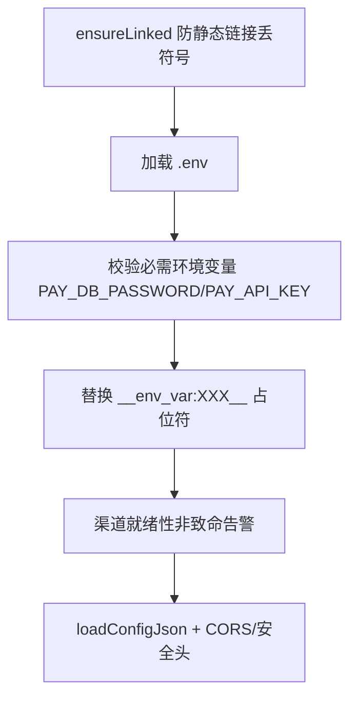

# pay-server 示例宿主

<cite>
**Referenced Files**
- [main.cc](file://examples/pay-server/main.cc)
- [config.json](file://examples/pay-server/config.json)
- [docker-compose.yml](file://examples/pay-server/docker-compose.yml)
- [HealthCheckController.h](file://examples/pay-server/controllers/HealthCheckController.h)
</cite>

## 启动流

`examples/pay-server/main.cc`：

Redis 密码有意可选（幂等不依赖 Redis）。密钥永不进源码：config 用占位符，真值走环境。

**Sources** · [main.cc](file://examples/pay-server/main.cc)

## config.json 插件配置键

插件块（config.json:187-228）：

| 键 | 说明 |
|----|------|
| base_path | 路由前缀，默认 /api/pay |
| db_client / redis_client | Drogon 客户端名 |
| idempotency_ttl_seconds | 幂等 TTL，默认 604800 |
| reconcile{enabled,interval_seconds,batch_size} | 对账开关/周期/批量 |
| channels.wechat{…13 键} | mchid/appid/证书/密钥/APIv3 key 等 |
| channels.alipay{…9 键} | app_id/私钥/网关（沙箱默认 alipaydev）等 |

`custom_config.pay` 提供 api_keys / api_key_scopes / api_key_default_scopes。另有三个宿主插件：PromExporter、AccessLogger、Hodor 限流（IP 100/min，create 20、refund 10 子限额）。

**Sources** · [config.json:187-228](file://examples/pay-server/config.json#L187-L228) · [configuration_guide.md](file://docs/development/configuration_guide.md)

## 宿主自有路由

- `/healthz`、`/readyz`（HealthCheckController.h，3 次失败阈值 + 滞回）；
- `/metrics` 聚合 PromExporter 基础指标 + `PayAuthMetrics::toPrometheus()`。

这些是宿主关注点，不在插件路由表内。

**Sources** · [HealthCheckController.h](file://examples/pay-server/controllers/HealthCheckController.h)

## Docker 与部署资产

`docker-compose.yml`：postgres15 挂载根 sql/ 初始化（新卷首次必须 `migrate_db.py --baseline` 采纳）、redis7、payserver（构建上下文为仓库根、密钥 `${VAR:?}` 强制）、Prometheus/Grafana 走 monitoring profile。`deploy/` 含 Prometheus 配置、告警规则、Grafana 面板与备份/恢复/重启运维脚本。

## 孪生脚本

`scripts/` 下 build / test / setup_database / deploy / check_config 各有 .sh/.bat 逐参数对齐（check_docs_drift R7 守护）；e2e 刻意是 bash + PowerShell（cmd 表达不了数组与 `[[ ]]`）。Windows 批处理注意：`shift` 会覆盖 %0 导致 %~dp0 失效，脚本已规避。

**Sources** · [docker-compose.yml](file://examples/pay-server/docker-compose.yml) · [check_docs_drift.py](file://scripts/check_docs_drift.py)
