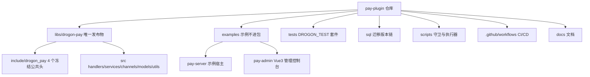

# 项目概览

<cite>
**Referenced Files**
- [README.zh-CN.md](file://README.zh-CN.md)
- [CMakeLists.txt](file://CMakeLists.txt)
- [conanfile.py](file://conanfile.py)
- [docs/README.md](file://docs/README.md)
- [PayPlugin.h](file://libs/drogon-pay/include/drogon_pay/PayPlugin.h)
</cite>

## 目录
1. [项目定位](#项目定位)
2. [核心能力](#核心能力)
3. [仓库布局](#仓库布局)
4. [版本与兼容矩阵](#版本与兼容矩阵)
5. [三步接入](#三步接入)
6. [知识库导航](#知识库导航)

## 项目定位

drogon-pay 是 Drogon C++ 框架的**可复用支付插件库**：把完整支付能力封装为标准 `drogon::Plugin`，以 Conan 静态库包发布，CMake 目标 `DrogonPay::DrogonPay`。宿主应用只需依赖、链接、配置三步即可获得支付能力，无需理解渠道协议细节。

唯一发布物是 `libs/drogon-pay/`；`examples/`、`tests/` 不进包（`conanfile.py` 的 exports_sources 控制）。库绝不依赖任何宿主代码，这条方向由 CI 架构守卫强制。

**Sources** · [conanfile.py](file://conanfile.py) · [README.zh-CN.md](file://README.zh-CN.md)

## 核心能力

| 能力 | 说明 |
|------|------|
| 支付创建 | 普通下单与扫码（qrpay）双路径，事务先落库再调渠道 |
| 查询 | 订单查询（DB 优先、渠道实时查询降级）、订单列表 |
| 退款 | 超退防护（FOR UPDATE + SUM 校验）、部分退款、幂等重试 |
| 回调验签 | 微信 V3 全链路（验签→解密→四闸门→CAS→COMMIT 后 ACK）；支付宝独立验签路径 |
| 幂等 | 数据库唯一真相源，五态语义，快照先于响应 |
| 对账 | 专用 worker 线程三路 sweep + 幂等 GC，默认 300s 周期 |
| 内置渠道 | 微信支付 V3、支付宝（沙箱网关默认） |
| 自定义渠道 | PaymentChannel SPI + registerFactory 宿主侧扩展 |

## 仓库布局

注意：`libs/drogon-pay/src/models_backup/` 是历史遗留备份目录（gitignored），不是现役代码；现役 ORM 模型在 `src/models/`，由 drogon_ctl 生成、禁止手改。

**Sources** · [conanfile.py](file://conanfile.py) · [docs/README.md](file://docs/README.md)

## 版本与兼容矩阵

版本声明**只有四处**，由 `scripts/check_version_sync.py` 强制一致：

1. `CMakeLists.txt` 的 `project(drogon-pay VERSION …)`
2. `conanfile.py` 的 `version`
3. `examples/pay-admin/package.json` 顶层 `version`
4. `examples/pay-server/openapi.yaml` 的 `info.version`（契约向消费者发布版本）

| 依赖 | 版本 | 约束性质 |
|------|------|----------|
| C++ 标准 | C++17 | 工具链要求 |
| Drogon | 1.9.13 | **钉死**：静态库 + C++ ABI 决定库与宿主必须同版 |
| OpenSSL | 3.5.7 | conanfile force 覆盖 |
| jsoncpp | 1.9.5 | conanfile force 覆盖 |
| PostgreSQL | 13+ | 运行时 |
| Redis | 6+ | 可选（防重放与写穿透；幂等不依赖） |

**Sources** · [conanfile.py](file://conanfile.py) · [CMakeLists.txt](file://CMakeLists.txt)

## 三步接入

1. **Conan 依赖**：宿主 conanfile 添加 `drogon-pay` 依赖（Drogon 版本必须与库一致）。
2. **CMake 链接**：`find_package(DrogonPay REQUIRED)` + `target_link_libraries(... DrogonPay::DrogonPay)`。
3. **配置插件**：宿主 config.json 添加 `drogon_pay::PayPlugin` 插件块（db_client、base_path、channels 等），再执行 `scripts/migrate_db.py` 建表。

消费者视角由 `test_package/` 端到端验证：`conan create` 时以最小宿主 find_package 链库、加载插件、断言路由可达。详见「构建体系」页。

**Sources** · [plugin_integration.md](file://docs/development/plugin_integration.md) · [test_package/conanfile.py](file://test_package/conanfile.py)

## 知识库导航

- **架构设计**：分层与依赖守卫、插件装配生命周期、渠道 SPI 与注册中心
- **核心业务模块**：支付创建与查询、退款、回调验签、幂等、对账、内置渠道
- **数据层**：六表模型与状态机、迁移工程
- **HTTP契约与安全**：路由表、鉴权、错误映射
- **示例应用**：pay-server 宿主、pay-admin 控制台
- **构建与测试**：Conan2+CMakePresets、DROGON_TEST、覆盖率棘轮
- **CI/CD与发布**：门禁、版本治理、部署流水线
- **运维与监控** / **开发者指南**

深度分析报告（含文档口径差异清单与已知风险）见 [docs/review/2026-11-12-project-deep-analysis.md](file://docs/review/2026-11-12-project-deep-analysis.md)。
